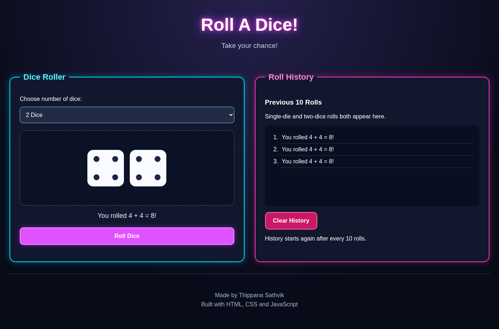
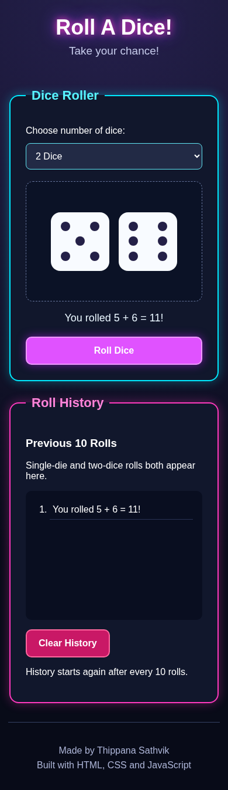

** Roll A Dice! 🎲 **

A simple dice rolling website for the Programming Club induction.

## Features

Choosing 1 Die or 2 Dice.The number of visible dice changes immediately.
Roll standard six sided dice with random results from 1 to 6.
Shows each die as a white square with the correct dots and show the total of two dice.
Showing ""No rolls yet!"" until the first roll.
Keep one combined history of single die and two dice roll events.
On the 11th roll, It  will start a fresh history batch from roll 1 (after the first 10 entries).
""Clear History"" button empties the list manually.
Neon colours.
Have a responsive desktop layout and also mobile layout.

## Website Screenshots

### Desktop View

### Mobile View

Note: The current design intentionally shows dice results instantly, without a rolling animation.

## How to Run

1. Open the `Dice-Empire` folder in VS Code.
2. Open `index.html` with **Live Server**, or double-click `index.html` to open it in Chrome.
3. Choose one or two dice and press **Roll Dice**.

No libraries, build tools, or backend are required.

Each click of "Roll Dice" counts as one roll event,whether one or two dice are selected. History is currently stored in memory, so it resets if the page is refreshed.

Made by ""Thippana Sathvik"".
